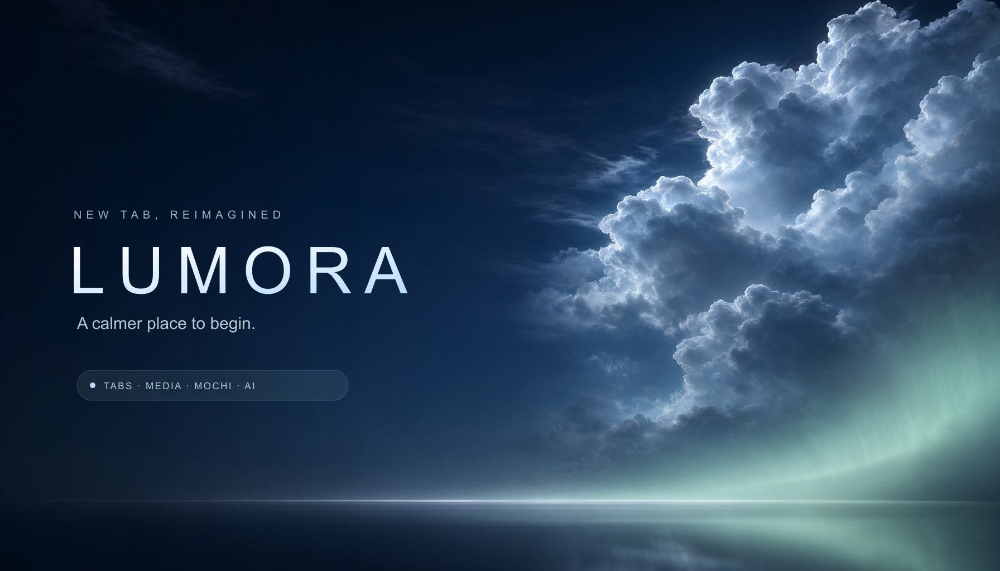
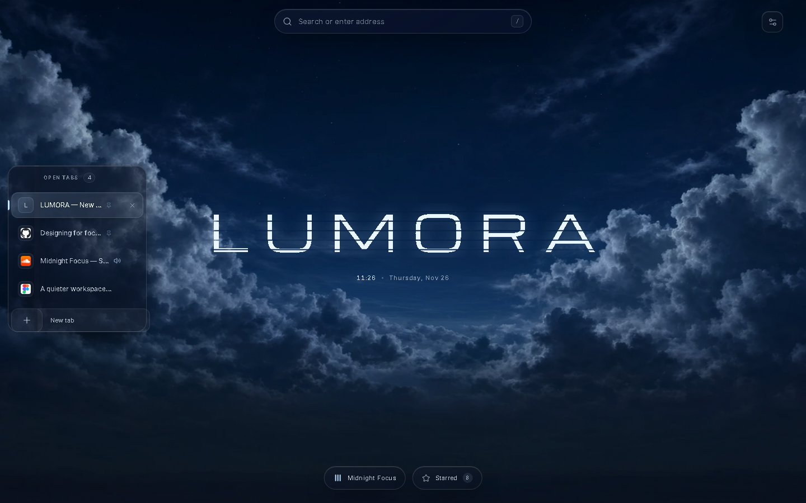
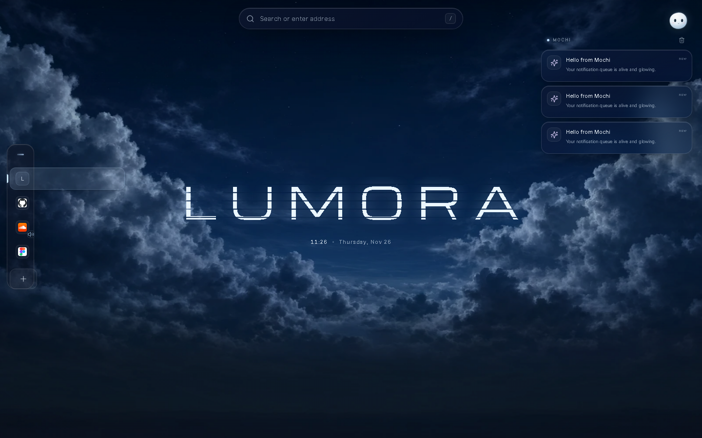
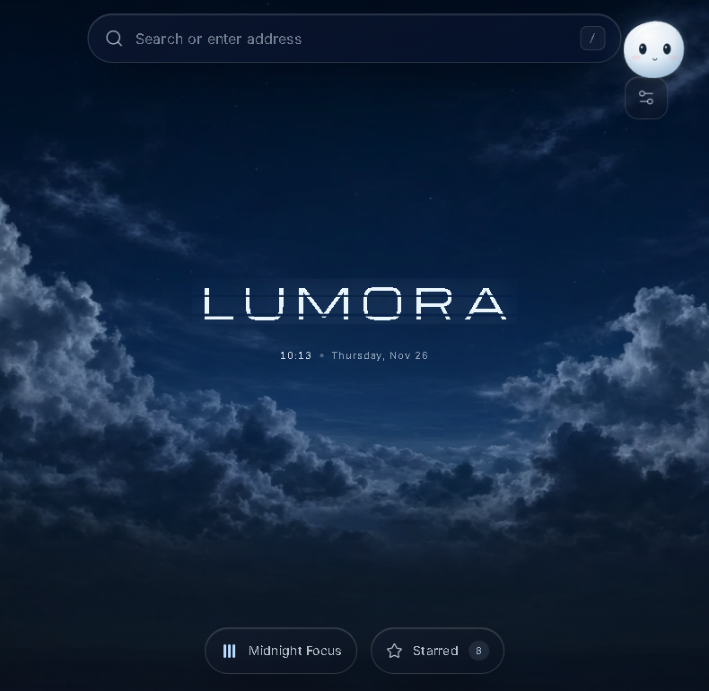
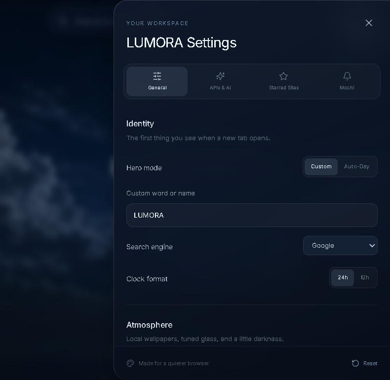

<p align="center">
  
</p>

<p align="center">
  <strong>A calmer place to begin.</strong><br>
  An atmospheric Manifest V3 new-tab workspace for Chrome and Edge.
</p>

<p align="center">
  
  
  
  
</p>

---

LUMORA replaces the new-tab page with a quiet, glassmorphic workspace: a cinematic local wallpaper, smart search, live clock, vertical tabs, browser-wide media controls, starred sites, and an original animated notification companion called Mochi. Gemini AI and weather are optional; neither is required for the extension to work.

No LUMORA backend, account, analytics, or telemetry is used.

## Preview

<p align="center">
  
</p>

<p align="center">
  
</p>

<details>
  <summary>Compact layout and settings</summary>
  <p align="center">
    
    
  </p>
</details>

## Features

### Atmosphere and identity

- Bundled midnight cloud wallpaper for instant first paint.
- Midnight, Glacier, and Ember presets.
- HTTPS wallpaper URLs and local image uploads.
- Uploaded images live in IndexedDB, not in extension storage.
- Adjustable background dim, vignette, and glass blur.
- Geometric LUMORA hero, custom text, or local Auto-Day mode.
- Live local time and date with 12-hour or 24-hour formatting.
- Optional current weather.

### Search and navigation

- Frosted search bar with a `/` keyboard shortcut.
- Recognizes URLs, domains, IP addresses, and localhost.
- Routes ordinary text to Google, DuckDuckGo, Perplexity, or Bing.
- Search navigates the current tab; there is no hidden search proxy.

### Tabs and media

- Full-height glass tab rail with active, audible, and muted indicators.
- Hover or keyboard focus reveals tab titles and close controls.
- Switch tabs, close tabs, middle-click to close, or open a new tab.
- Live updates for created, removed, updated, activated, and moved tabs.
- HTML5 media discovery across open tabs.
- Media metadata from `navigator.mediaSession` when the site provides it.
- Mini-player with play/pause, mute, progress, and jump-to-tab.
- Previous/next controls cycle through multiple audible tabs.
- Optional automatic hiding when no media is active.
- Restricted browser pages are ignored gracefully.

### Starred sites

- Twenty curated shortcuts: YouTube, GitHub, ChatGPT, Claude, Gemini, Gmail, X, Reddit, Spotify, Netflix, Notion, Figma, LinkedIn, Twitch, Discord, Instagram, WhatsApp Web, Amazon, Stack Overflow, and Vercel.
- Toggle curated sites individually.
- Add custom names and URLs.
- Favicon loading with a clean monogram fallback.

### Mochi notifications

- Compact original animated SVG companion that appears only while notifications are present.
- Random natural blinking and notification celebration motion.
- Ice Blue, Warm Pearl, Soft Mint, and Lavender glow presets.
- Maximum three-card FIFO queue with animated removal.
- Do Not Disturb mode, clear-all, per-card dismissal, and test notifications.
- Local in-extension notifications when a Chrome download completes.
- Mochi can be disabled completely.

### Optional Gemini sidebar

- Gemini 2.5 Flash streaming responses.
- Markdown and GitHub-flavored Markdown rendering.
- Syntax-highlighted code with one-click copy.
- Stop generation, clear chat, and suggested prompts.
- `Alt + L` toggles the sidebar.
- Your key is stored locally and sent only in the `x-goog-api-key` header to Google's Gemini API.

### Weather

- Keyless Open-Meteo integration by saved city or browser geolocation.
- Optional OpenWeatherMap API key and city override.
- Coordinates are persisted locally to avoid repeated location prompts.
- Ten-minute refresh with abort support.

## Keyboard shortcuts

| Shortcut | Action |
| --- | --- |
| `/` | Focus the search bar |
| `Alt + L` | Open or close the Gemini sidebar when AI is enabled |
| `Escape` | Close the active drawer, sidebar, or popover |
| `Tab` / `Shift + Tab` | Navigate controls with visible focus |
| Middle-click a tab row | Close that tab |

## Requirements

- A current Chromium browser with Manifest V3 support, such as Google Chrome or Microsoft Edge.
- Node.js 20.19+ or 22.12+ for development and packaging.
- npm for dependency installation.

Gemini and OpenWeatherMap require your own API key. Open-Meteo weather, local wallpapers, search, tabs, media, starred sites, and Mochi require no key.

## Install for development

```bash
git clone <your-repository-url>
cd Lumora
npm install
npm run dev
```

Open the Vite URL printed in the terminal. The browser preview uses local development storage and demo tab/media data so every panel remains testable without extension APIs.

## Load the extension locally

```bash
npm run build
```

1. Open `chrome://extensions` or `edge://extensions`.
2. Enable **Developer mode**.
3. Select **Load unpacked**.
4. Choose the generated `dist` directory.

The toolbar icon opens a new LUMORA tab.

## Create a Chrome Web Store package

```bash
npm run package
```

This rebuilds the extension, validates its Manifest V3 structure and CSP, then creates:

```text
release/lumora-1.0.0.zip
```

Upload that ZIP directly in the Chrome Web Store Developer Dashboard. Its root contains `manifest.json`; there is no extra enclosing folder.

Before submission:

1. Publish the contents of [PRIVACY.md](PRIVACY.md) at a public HTTPS URL and enter it in the store listing.
2. Add the store description, category, language, and screenshots.
3. Use `public/icons/icon128.png` for the store icon.
4. Explain the `<all_urls>` permission using the justification below.
5. Complete any required developer contact and privacy declarations.

### Host-permission justification

LUMORA needs access to ordinary web pages to detect HTML5 video/audio elements and Media Session metadata, and to relay the user's play/pause command to the correct tab. The content script reads media state only; it does not collect page text, form values, cookies, or browsing history. LUMORA is not a content blocker, VPN, proxy, or remote code host.

## Configuration

Open **Settings → APIs & AI** to configure optional integrations.

### Gemini

1. Create a Gemini API key in Google AI Studio.
2. Enable **AI Sidebar**.
3. Paste the key into the Gemini field.
4. Open the right-edge AI trigger or press `Alt + L`.

Chat requests go directly from the browser to:

```text
https://generativelanguage.googleapis.com/v1beta/models/gemini-2.5-flash:streamGenerateContent?alt=sse
```

### Weather

- Leave the OpenWeatherMap key empty to use keyless Open-Meteo.
- Enter a city for geocoded weather, or use browser geolocation.
- Location permission is requested only when browser geolocation is used.
- Add an OpenWeatherMap key to use that provider instead.

## Data and privacy

- Settings and API keys are stored in `chrome.storage.local`.
- Uploaded wallpaper blobs are stored in IndexedDB.
- No data is sent to a LUMORA server because there is no LUMORA server.
- Chat content is sent to Google only when you use Gemini.
- City or coordinates are sent to the selected weather provider only when weather is enabled.
- A remote wallpaper URL causes the browser to request that image from its host.
- Download filenames are used only to display a local notification.
- Media title, artist, artwork, source, position, duration, and playback/mute state are kept in the extension's in-memory service-worker map and displayed to you.
- There are no cookies, analytics scripts, tracking pixels, advertising IDs, or remote fonts.

See [PRIVACY.md](PRIVACY.md) for the full policy.

To delete local data, use **Settings → Reset**, remove uploaded wallpapers with **Remove**, or uninstall the extension. API providers retain data according to their own policies.

### Runtime flow

1. The service worker tracks browser tabs and in-memory media sessions.
2. The isolated-world content script discovers media and emits state updates.
3. Runtime messages broadcast changes to the new-tab page.
4. Media commands are relayed back to the originating tab.
5. Settings synchronize through `chrome.storage.local`; wallpaper blobs use IndexedDB.
6. Optional API calls go directly from the extension page to their configured provider.

## Validation

```bash
npm run check       # Strict TypeScript and source validation
npm run build       # Production build and extension validation
npm run smoke:ui    # Optional 1440×900 headless browser test
```

The smoke test requires the Vite dev server to be running and an installed Chrome or Edge executable. Set `LUMORA_BROWSER` if the browser is installed in a nonstandard location. It verifies the desktop tab rail, settings drawer, viewport overflow, Mochi notification lifecycle, and runtime exceptions, and saves previews to `docs/assets/lumora-desktop.png` and `docs/assets/lumora-notification.png`.

## Browser behavior

- Sites can block media playback; browser autoplay policy still applies.
- Media support depends on the site using standard HTML5 media or Media Session APIs.
- `chrome://`, `edge://`, the Chrome Web Store, and other restricted pages cannot receive scripts.
- Uploaded wallpapers remain on your device.
- Remote wallpaper hosts and API providers receive the network requests needed to serve their content.

## Credits

- [Coucou](https://github.com/louis-cfm/coucou) was the requested visual reference for the companion concept. Mochi is original LUMORA artwork; no Coucou character, sound, or application asset is bundled.
- [Inter](https://github.com/rsms/inter) and [Michroma](https://fonts.google.com/specimen/Michroma) are bundled locally with their license files.
- [Lucide](https://lucide.dev) provides interface icons.
- [React Markdown](https://github.com/remarkjs/react-markdown), [Remark GFM](https://github.com/remarkjs/remark-gfm), [Rehype Highlight](https://github.com/rehypejs/rehype-highlight), and [Highlight.js](https://highlightjs.org) power AI response rendering.
- The default wallpaper, extension icon, banner, and Mochi artwork were created for LUMORA.

## License

Released under the [MIT License](LICENSE).
